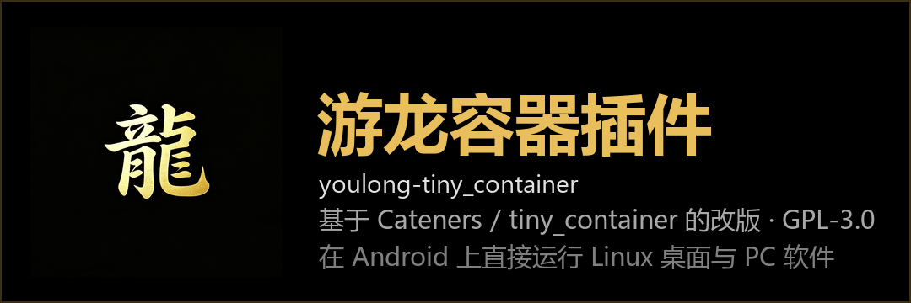

**English** | [简体中文](README.md)

# Youlong Container Plugin · youlong-tiny_container

> Linux is powerful. Linux can also be easy to use.
>
> **Install it and instantly get a Linux computer on your phone or tablet — run PC software right away.**

[](COPYING)
[](https://github.com/Cateners/tiny_container)

This is a fork / remake of **[Cateners/tiny_container](https://github.com/Cateners/tiny_container)**, released under the **same GNU GPL-3.0** license.
The upstream project already does a great job at "running a Debian desktop on Android". This remake adds the things Chinese-speaking users ask for most: a built-in Steam, Douyin (TikTok China) web version, a **real PC keyboard** panel, a **termux-desktop** display mode (**now the default**), an orientation prompt on first launch, and more.

> [!IMPORTANT]
> Like upstream, this project makes **heavy use of AI** (code logic, wording, translations). Some bugs may remain — please be aware.



---

## What this remake changes

### 1. Default display mode: termux-desktop

- A **third graphical display mode `termux-desktop`** was added and made the **default** one (upstream defaults to VNC).
- **13 desktop environments** to choose from: Xfce, LXQt, Openbox, MATE, Cinnamon, KDE Plasma, i3, Fluxbox, IceWM, Awesome, dwm, bspwm, Window Maker.
- Inspired by [sabamdarif/termux-desktop](https://github.com/sabamdarif/termux-desktop). The upstream installer is Termux-native (depends on `$PREFIX`) and cannot run inside a proot Debian, so here:
  - only lightweight session scripts are baked into the rootfs (`/opt/tiny/termux-desktop/td-session.sh`, ...);
  - desktop environments are installed on demand via `apt`;
  - the built-in Termux:X11 frontend is reused for display.
- Display modes are mutually exclusive (`webview` / `avnc` / `x11` / `termux-desktop`); this remake enables only `termux-desktop` by default.

### 2. PC keyboard mode

- The **"keyboard" button of all three display modes** (VNC / Termux:X11 / termux-desktop) is taken over: tapping it offers **"PC keyboard" or "phone keyboard"**.
  - **VNC** is slightly different: tapping the toolbar keyboard button opens the **PC keyboard directly**; **long-press** gives the choice.
- The PC keyboard is a **6-row panel** imitating a real keyboard (horizontally scrollable on narrow screens):
  - `Esc` `F1`~`F12` `Ins` `Del` / `` ` `` `1`~`0` `-` `=` `Home` `⌫` / `Tab` `Q`~`P` `[` `]` `\` `PgUp` / `Caps` `A`~`L` `;` `'` `⏎` `PgDn` / `⇧` `Z`~`M` `,` `.` `/` `End` / `Ctrl` `Win` `Alt` `Space` `←` `↑` `↓` `→`
  - Modifiers (`Ctrl` / `Win` / `Alt` / `Shift`): **tap = applies to the next key only**, **long-press = lock** (tap again to release).
  - Keys are injected with `dispatchKeyEvent`, i.e. exactly the same path as a real external keyboard, so `F11` / `F12` work.
- **Robustness (VNC)**: AVNC rebuilds its toolbar and overwrites listeners, therefore
  - a **self-healing poll** re-installs the listener every 600 ms while the activity is resumed;
  - a **floating keyboard button** is always added as a fallback entry point.
- Debug tag: `adb logcat -s TC4KBD`.

### 3. Bundled software

- **Steam (Windows build)**: runs the official `SteamSetup.exe` on top of the Hangover/Wine setup included in the container, with quick commands such as "install", "update to the latest version", "uninstall".
- **Douyin web version**: `firefox-esr` with a dedicated profile, so your main browser configuration stays clean.
  - The Douyin Windows client (Electron **32-bit x86**) is effectively unusable on ARM64 + Wine (too many translation layers), so it was removed from the image.
- **Hangover/Wine option**: enabling it makes the container install Wine on first start.

### 4. UI / UX

- App name "游龙容器插件", application id `com.youlong.computer` (upstream: `com.fct.tc4`).
- New **launch page** with a big "Launch" button and 4 bottom tabs (Launch / Quick commands / Features / Settings).
- A **legal notice / disclaimer** dialog is shown on first start.
- The "Help" page lists: **upstream repo / this repo / open-source libraries / license**.
- **Orientation is asked the first time you enter a graphical session**: landscape / portrait / **follow the phone** (works for VNC, Termux:X11 and termux-desktop).
- New **launcher icon** (adaptive icon, including the Android 13+ themed `monochrome` layer).
- Wallpapers `4k.jpg` and `bz.png` are bundled in the container image.

---

## Download

APKs are on the **[Releases](https://github.com/iill392/youlong-tiny_container/releases)** page.

> The APK is about 1 GB because **the container image is packaged inside it**, so no download is needed on first launch.

## Build

Requirements: JDK 21, Android SDK Platform 37, Android NDK (any version supported by AGP 9.2.1), CMake 3.22.1, Gradle Wrapper 9.5.1 / AGP 9.2.1, ABI `arm64-v8a`.

```bash
git clone https://github.com/iill392/youlong-tiny_container.git
cd youlong-tiny_container
echo "sdk.dir=/path/to/Android/sdk" > local.properties
./gradlew assembleRelease
```

- The prebuilt `jniLibs` (proot and friends, ~6.5 MB) **are included in this repository**, so it builds out of the box. (Upstream ships them as `jniLibs.zip` on its Releases page.)
- The container image `app/src/main/assets/rootfs.tar.zst` is **not** distributed in this repository (~968 MB, over GitHub's 100 MB per-file limit). Drop your own copy there if you want the automatic container installation on first launch; the project compiles fine without it.

## Credits

- **[Cateners / Caten Hu](https://github.com/Cateners)** for [Tiny Container](https://github.com/Cateners/tiny_container) — this remake would not exist without it.
- The [termux](https://github.com/termux) community, [tmoe](https://github.com/2moe/tmoe), [avnc](https://github.com/gujjwal00/avnc), [termux-x11](https://github.com/termux/termux-x11), [sabamdarif/termux-desktop](https://github.com/sabamdarif/termux-desktop).
- vinceliuice's [Fluent](https://github.com/vinceliuice/Fluent-gtk-theme) theme, lxgw's [Kose font](https://github.com/lxgw/kose-font).
- The [Debian](https://www.debian.org/) project and every open-source maintainer.

## License

**GNU General Public License v3.0 or later**, identical to upstream. See [COPYING](COPYING) and [NOTICE.md](NOTICE.md).

```
Copyright (C) 2026 Caten Hu        (upstream Tiny Container)
Copyright (C) 2026 Youlong iill392  (this remake: additions and modifications)
```
