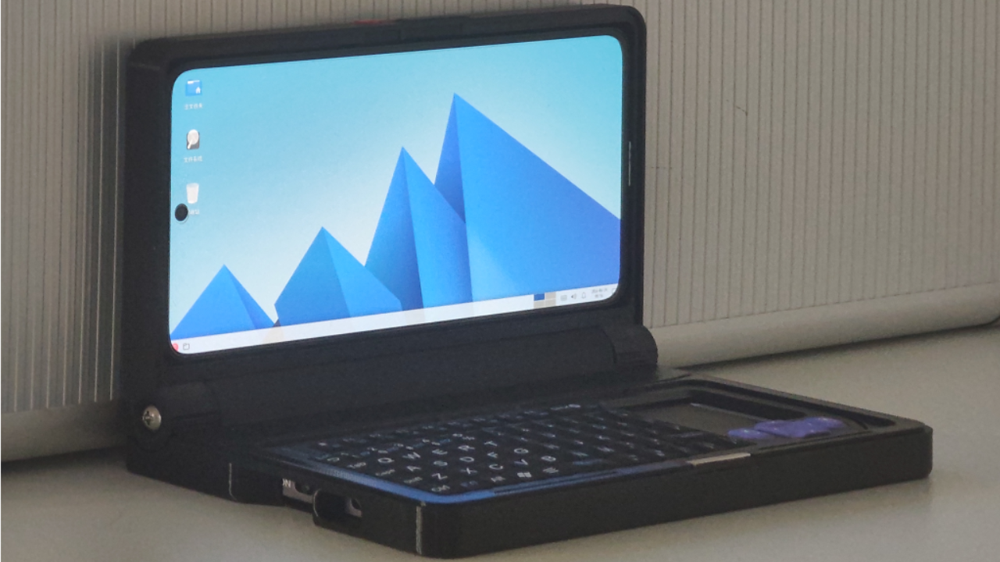

[English](README.en.md) | **简体中文**

# 游龙容器插件 · youlong-tiny_container

> Linux 很强大，Linux 也可以很好用。
>
> **装上游龙容器插件，手机/平板立刻拥有一台 Linux 电脑 —— 直接运行 PC 软件。**

[](COPYING)
[](https://github.com/Cateners/tiny_container)
[](#自己编译)

> 科技不再是高高在上，而是服务于人民 —— 向开源精神致敬。

本项目是 **[Cateners/tiny_container](https://github.com/Cateners/tiny_container)（Tiny Container / 小小容器）** 的改版，**一样是 GNU GPL-3.0 协议开源**。
原项目已经把「在 Android 上跑 Debian 桌面」这件事做得很棒，本改版在此基础上补齐了中文用户最常用的一些场景：**内置 Steam、抖音网页版、真实电脑键盘、termux-desktop 显示方式、默认 AVNC 显示、首次进入询问屏幕方向** 等等。

> [!IMPORTANT]
> 本改版同样**重度使用 AI** 辅助开发（代码逻辑、文案、翻译等），可能仍有未发现的 bug，请知悉。
> 截图/描述里的「原版」指上游 Tiny Container，「改版」指本项目。


---

## 本改版做了什么

### 一、默认显示方式：AVNC（VNC）

> 改版 10 起，容器默认图形显示方式已改回 **AVNC（内置 Xtigervnc）**，与上游一致。
> 改版 6~9 期间曾把默认改成 `termux-desktop`；`termux-desktop` 与 `x11` 仍然保留，
> 可以在「功能」卡片里随时切换（三者互斥）。

- 新增**第三种图形显示方式 `termux-desktop`**（改版 6 加入，改版 10 起不再是默认）。
- 支持 **13 种桌面环境**可选：Xfce、LXQt、Openbox、MATE、Cinnamon、KDE Plasma、i3、Fluxbox、IceWM、Awesome、dwm、bspwm、Window Maker。
- 参考 [sabamdarif/termux-desktop](https://github.com/sabamdarif/termux-desktop) 的思路实现。上游是 Termux 原生安装器（依赖 `$PREFIX`），无法直接在 proot Debian 中运行，因此本改版改为：
  - rootfs 内只烧录轻量启动脚本（`/opt/tiny/termux-desktop/td-session.sh` 等）；
  - 桌面环境按需 `apt` 安装；
  - 复用容器内置的 Termux:X11 前端显示。
- 图形显示方式互斥（`webview` / `avnc` / `x11` / `termux-desktop` 同时只能启用一个），改版里默认只启用 `avnc`。

### 二、电脑键盘模式（改版重点）

- 三种显示方式（VNC / Termux:X11 / termux-desktop）的**「键盘」按钮都会被接管**，点击后弹出**「电脑键盘 / 手机键盘」二选一**。
  - **VNC** 略有不同：点击工具栏键盘按钮**直接弹出电脑键盘**，**长按**才是二选一。
- 电脑键盘是仿真实键盘的 **6 行按键面板**（窄屏可横向滚动）：

  | 行 | 按键 |
  | --- | --- |
  | 功能键 | `Esc` `F1`~`F12` `Ins` `Del` |
  | 数字行 | `` ` `` `1`~`0` `-` `=` `Home` `⌫` |
  | QWERTY 上排 | `Tab` `Q`~`P` `[` `]` `\` `PgUp` |
  | QWERTY 中排 | `Caps` `A`~`L` `;` `'` `⏎` `PgDn` |
  | QWERTY 下排 | `⇧`(左右 Shift) `Z`~`M` `,` `.` `/` `End` |
  | 控制行 | `Ctrl` `Win` `Alt` `空格` `←` `↑` `↓` `→` |

  - 修饰键（`Ctrl` / `Win` / `Alt` / `Shift`）**轻点 = 只对下一个键生效**，**长按 = 锁定**（再点一次取消）。
  - 按键通过 `dispatchKeyEvent` 注入，与真实外接键盘走**同一条通路**，`F11`/`F12` 等全屏、刷新快捷键可用。
- **稳定性设计**（VNC 场景）：AVNC 会重建工具栏并覆盖监听器，所以加了
  - **自愈轮询**：界面在前台时每 600ms 无条件重装一次监听器，任何时刻被抢走都会在 1 秒内抢回来；
  - **悬浮键盘按钮兜底**：即使工具栏按钮永远接管不上，也还有浮动的键盘入口。
- 排查日志：`adb logcat -s TC4KBD`（会打印「已接管工具栏键盘按钮」或「未找到工具栏键盘按钮，改用悬浮按钮兜底」）。

### 三、内置软件

- **Steam（Windows 版）**：利用容器内置的 Hangover / Wine 运行官方 `SteamSetup.exe`，快捷命令组里带「安装 Steam」「升级到最新版」「卸载」等。
- **抖音网页版**：`firefox-esr` + 独立 profile（不污染主浏览器配置），快捷命令组「抖音」。
  - 抖音 Windows 客户端（Electron **32 位 x86**）在 ARM64 + Wine 的多层指令翻译下**实际不可用**，已从镜像中移除，只保留网页版。
- **Hangover Wine 配置**：随容器提供的 Option，开启后首次启动容器会自动安装 Wine。

### 四、界面与体验

- 应用名「游龙容器插件」，包名 `com.youlong.computer`（原版为 `com.fct.tc4`）。
- 首页新增**启动页**：一个大的「启动」按钮，底部 4 个标签页 —— 启动 / 快捷命令 / 功能 / 设置。
- 首次启动弹出**法律声明与免责声明**，点「同意」才继续。
- 「帮助」页改为 4 项：**原版仓库 / 游龙改版仓库 / 开源库 / 许可证**。
- **首次进入图形界面时询问屏幕方向**：横屏 / 竖屏 / **跟随手机**（选「跟随手机」后手机横过来界面就横过来）。VNC、Termux:X11、termux-desktop 都支持。
- **应用图标**换成金龍图标（自适应图标，含 Android 13+ 主题图标 `monochrome`）。
- 容器内置壁纸 `4k.jpg`（黑底金龍）与 `bz.png`，桌面默认使用。

### 五、容器镜像

- 桌面环境默认 Xfce；移除无用资源与已失效的客户端，压缩后镜像约 **968 MB**。
- 容器卡片预览图 / 壁纸取自镜像内 `/home/tiny/.local/share/backgrounds/`。

---

## 下载

APK 见 **[Releases](https://github.com/iill392/youlong-tiny_container/releases)** 页面。

> 安装包体积约 1 GB，因为**容器镜像直接打包在 APK 内**，装上就能用、无需联网下载镜像。

## 自己编译

**环境要求**

| 项目 | 版本 |
| --- | --- |
| JDK | 21（本项目用 Temurin 21 验证通过） |
| Android SDK Platform | 37（`compileSdk` / `targetSdk` = 37，`minSdk` = 28） |
| Android NDK | 任意 AGP 9.2.1 支持版本（本项目用 `27.0.12077973`） |
| CMake | 3.22.1（用 `sdkmanager` 安装即可） |
| Gradle | Wrapper 9.5.1（仓库自带） / AGP 9.2.1 |
| ABI | 仅 `arm64-v8a` |

```bash
git clone https://github.com/iill392/youlong-tiny_container.git
cd youlong-tiny_container

# 写好自己的 SDK 路径
echo "sdk.dir=/path/to/Android/sdk" > local.properties

./gradlew assembleRelease
# 产物：app/build/outputs/apk/release/app-release-unsigned.apk
```

**关于两处大文件**

1. **`jniLibs`（proot 等预编译 `.so`，约 6.5 MB）已内置在本仓库中**，clone 下来就能编译。
   （上游是把它们打包成 `jniLibs.zip` 放在 Releases 里让用户手动下载，本仓库为了省事直接放进来了；这些库来自上游对 [termux-packages](https://github.com/tiny-computer/termux-packages) 的 fork。）
2. **容器镜像 `app/src/main/assets/rootfs.tar.zst` 没有随仓库分发**：它约 **968 MB**，超过 GitHub 单文件 100 MB 的限制。
   - 想要「首次启动自动安装容器」，把这个文件放到 `app/src/main/assets/` 即可（可直接从本仓库 Releases 下载，或用 [tiny-computer/images](https://github.com/tiny-computer/images) 自行制作）；
   - 不放置也能正常编译，只是首次启动不会自动创建容器。

**签名**

自己编译出来的是未签名包，可以先用 debug 密钥签名试装：

```bash
BT=$ANDROID_HOME/build-tools/37.0.0
$BT/zipalign -f -p 4 app-release-unsigned.apk app-aligned.apk
$BT/apksigner sign --ks ~/.android/debug.keystore --ks-key-alias androiddebugkey \
    --ks-pass pass:android --key-pass pass:android app-aligned.apk
$BT/apksigner verify --print-certs app-aligned.apk
```

## 使用提示

- 屏幕显示太大或太小 → 「功能」→「AVNC」里调缩放。
- Android 存储默认挂载在 `/mnt/sdcard`，别忘了授予存储访问权限。
- Linux 应用识别不到麦克风 → 检查是否选中了麦克风（Tiny Microphone Input），或重启该应用。
- 默认图形显示方式可以在「功能」里切换（VNC / Termux:X11 / Termux Desktop，三者互斥）。

## 原版项目

- 上游：[Cateners/tiny_container](https://github.com/Cateners/tiny_container)（4.1k+ stars）
- 上游更早的 Tiny Computer 代码保留在其 `v1_tiny_computer` 分支。

## 致谢

- 感谢 **[Cateners / Caten Hu](https://github.com/Cateners)** 的 [Tiny Container](https://github.com/Cateners/tiny_container) —— 没有它就没有这个改版。
- 感谢 [termux](https://github.com/termux) 社区把这么多优秀的程序搬到 Android 上。
- 感谢 [tmoe](https://github.com/2moe/tmoe) 项目让容器配置变得简单。
- 感谢 [avnc](https://github.com/gujjwal00/avnc) 与 [termux-x11](https://github.com/termux/termux-x11) —— 容器使用的图形界面前端。
- 感谢 [sabamdarif/termux-desktop](https://github.com/sabamdarif/termux-desktop) —— 本改版第三种显示方式的参考。
- 感谢 vinceliuice 的 [Fluent](https://github.com/vinceliuice/Fluent-gtk-theme) 主题、lxgw 的 [霞鹜文楷](https://github.com/lxgw/kose-font) 字体。
- 感谢 [Debian](https://www.debian.org/) 项目与所有开源维护者。



*（上图为上游 Tiny Container 界面）*

## 许可证

本项目以 **GNU General Public License v3.0 or later** 发布，与上游完全一致。完整协议见 [COPYING](COPYING)，版权与来源说明见 [NOTICE.md](NOTICE.md)。

```
Copyright (C) 2026 Caten Hu          （上游 Tiny Container）
Copyright (C) 2026 游龙 iill392        （本改版新增/修改部分）
```

本程序是自由软件：你可以依照自由软件基金会发布的 GNU 通用公共许可证（第 3 版或更高版本）条款重新发布和/或修改它。
本程序基于「有用」的目的分发，但**不提供任何担保**，甚至不提供适销性或特定用途适用性的默示担保。详见 GNU 通用公共许可证。
